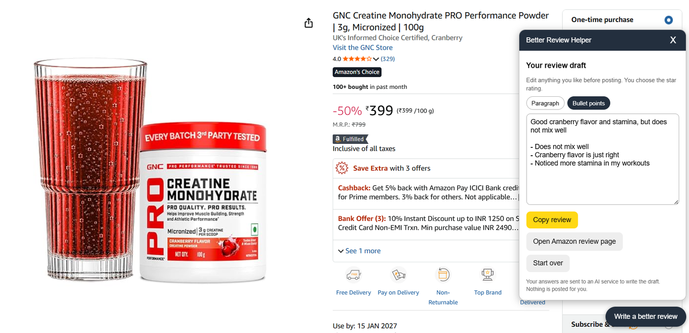
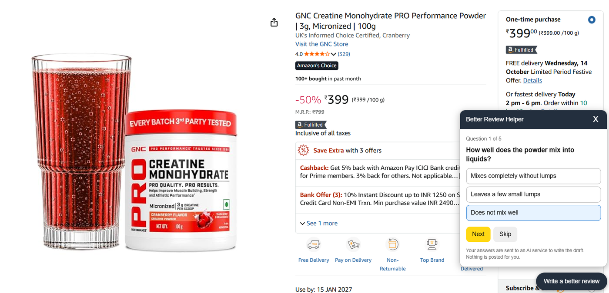
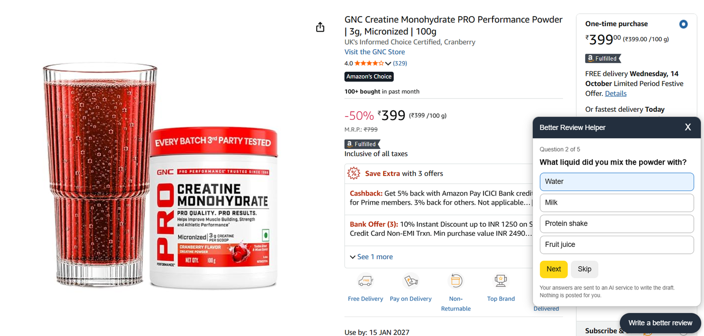
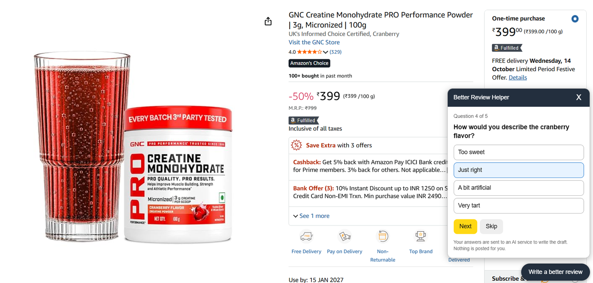
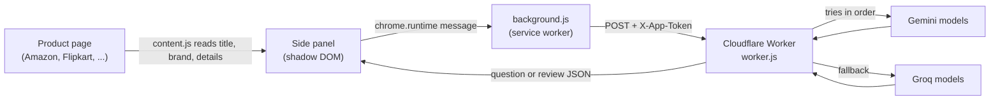

<div align="center">


# Better Review Helper

**Answer 5 quick questions. Get a clear, useful review draft for the next buyer.**

A Chrome extension that asks product-specific questions, then turns *your* answers into a wholesome review. It works on Amazon.in, Flipkart, Myntra, Meesho, Nykaa and Ajio.


[The problem](#the-problem) · [See it in action](#see-it-in-action) · [How it works](#how-it-works) · [Run it locally](#run-it-locally) · [Customise](#customise) · [Learnings](#what-i-learned-building-this)

<br />



<sub>The finished draft on an Amazon.in product page. You edit it, you pick the star rating, you post it.</sub>

</div>

---

## The problem

Most product reviews are not very useful, and that has a real cost for the next buyer.

- Reviews are one-liners such as "good", "waste of money", "not as expected". They say nothing about *how* the product was used.
- Many bad reviews are not about a bad product. They come from using it the wrong way, or from not knowing how to use it at all. A future buyer reading those reviews cannot tell the difference.
- The people who could write a helpful review have no reason to spend ten minutes on it. The reward goes to a stranger who buys later, not to the writer.

The result is that buyers do hours of research outside the shopping site (YouTube, Reddit, family) just to learn what a good review would have told them in a paragraph.

**Better Review Helper lowers the effort to a few taps.** It reads the product page, asks short multiple-choice questions that fit *this* product, and drafts a review from the answers. The review then carries the context a future buyer needs: how long it was used, how it was used, how it was looked after, and what actually happened.

> The questions are generated per product, but the review content is never decided by the tool. It only reorganises what the buyer answered. Nothing the buyer did not say is added, and no star rating is chosen.

You can read the story behind the idea in [Learnings](#what-i-learned-building-this).

## See it in action

The example below is a creatine powder on Amazon.in. Notice that the questions are about *mixing* and *flavour*, which is what a buyer of a powder supplement cares about. A pan would get different questions.

<table>
  <tr>
    <td width="33%"></td>
    <td width="33%"></td>
    <td width="33%"></td>
  </tr>
  <tr>
    <td align="center"><sub><b>Question 1 of 5</b><br />Generated from the product listing</sub></td>
    <td align="center"><sub><b>Question 2 of 5</b><br />Follows on from your earlier answers</sub></td>
    <td align="center"><sub><b>Question 4 of 5</b><br />Still specific to this product</sub></td>
  </tr>
</table>

The flow is always the same:

1. Open a product page. A **Write a better review** button appears.
2. Pick how long you have used the product (this is a fixed first question).
3. Answer up to 5 AI-generated questions. Every question can be skipped, and the last one also accepts your own words.
4. Get a draft as a **Paragraph** or **Bullet points**. Edit it freely.
5. **Copy review** and paste it into the shop's review box. On Amazon.in there is also a button that opens the review page for you.

## Highlights

- **Questions that fit the product.** The model decides what a future buyer of this exact product would want to know, for any category.
- **Honest by design.** Neutral, non-leading questions. The review uses only the buyer's own answers.
- **Fair about problems.** If you report a problem, the tool asks about the circumstances (how it was used or looked after) in a neutral, non-blaming way.
- **Handles "not used yet".** Then it only asks about delivery, packaging, build and listing accuracy.
- **Never posts for you.** You review, edit, choose the stars and paste.
- **Reliable backend.** Tries a list of Gemini models first, then Groq models, until one gives a usable answer.
- **No build step.** Plain JavaScript. No npm install for the extension or the Worker.

## Supported sites

| Site | Button on product pages | Direct link to the review page |
| --- | :---: | :---: |
| Amazon.in | Yes | Yes |
| Flipkart | Yes | Shows instructions (My Orders) |
| Myntra | Yes | Shows instructions (mostly app-based) |
| Meesho | Yes | Shows instructions (mostly app-based) |
| Nykaa | Yes | Shows instructions |
| Ajio | Yes | Shows instructions |

Shopping sites change their page layout often. If the tool reads a page badly, see [Customise](#customise).

## How it works



| Part | File | What it does |
| --- | --- | --- |
| Content script | `extension/content.js` | Detects product pages, reads the listing, draws the panel, runs the question flow. |
| Background worker | `extension/background.js` | Sends requests to your backend. It holds the backend URL and app token. |
| Manifest | `extension/manifest.json` | Chrome permissions and the list of supported sites. |
| Backend | `worker/worker.js` | Holds the two prompts, calls the LLMs, validates their JSON, rejects bad requests. |
| Tests | `worker/test_worker.mjs` | 18 checks of the Worker with mocked LLM responses. No API keys needed. |

The Worker has two modes:

- `question`: given the product, how long it has been used and the answers so far, return one new question with 3 to 5 options.
- `summary`: given the same data plus all answers, return a headline, a short paragraph and bullet points.

## Run it locally

You run two things: a small **backend** (a Cloudflare Worker that talks to the AI models) and the **extension** (loaded in your browser). The backend is needed because the API keys must never sit inside the extension.

### What you need

- A Chromium-based browser: Chrome, Edge or Brave.
- A free [Cloudflare](https://dash.cloudflare.com/sign-up) account.
- At least one LLM API key. Both of these have free tiers:
  - Gemini: [Google AI Studio](https://aistudio.google.com/apikey)
  - Groq: [Groq Console](https://console.groq.com/keys)
- Node.js 18 or newer, only if you want to run the tests.

Using both keys is recommended. If one provider is rate-limited or down, the Worker falls back to the other.

### 1. Get the code

```bash
git clone https://github.com/YOUR_USERNAME/YOUR_REPO.git
cd YOUR_REPO
```

### 2. Make an app token

The app token is a shared password between the extension and your Worker. Make any long random string, for example:

```bash
openssl rand -hex 16
```

Keep it. You will use the same value in steps 3 and 4.

### 3. Deploy the backend on Cloudflare

1. In the Cloudflare dashboard, go to **Workers & Pages** and create a new Worker. Give it a name, for example `review-helper`, and deploy the starter code.
2. Open the Worker, choose **Edit code**, delete the starter code, paste in the full contents of [`worker/worker.js`](worker/worker.js), and **Deploy**.
3. Open the Worker's **Settings**, then **Variables and Secrets**, and add:

   | Name | Type | Value |
   | --- | --- | --- |
   | `APP_TOKEN` | Secret | The token from step 2 |
   | `GEMINI_API_KEY` | Secret | Your Gemini key |
   | `GROQ_API_KEY` | Secret | Your Groq key |
   | `GEMINI_MODELS` | Text (optional) | Comma-separated model names, for example `gemini-3.5-flash,gemini-3.1-flash-lite` |
   | `GROQ_MODELS` | Text (optional) | For example `openai/gpt-oss-120b` |
   | `GEMINI_THINKING` | Text (optional) | For example `low` |

   If you leave the model variables empty, the Worker uses `gemini-3.5-flash` and `openai/gpt-oss-120b`. Model names change over time, so if a call fails, check the current names in the Gemini and Groq docs. The Worker tries all Gemini models first, then all Groq models, in the order you list them.
4. Deploy again if the dashboard asks you to. Copy your Worker URL. It looks like `https://review-helper.YOUR-SUBDOMAIN.workers.dev`.

Menu names in the Cloudflare dashboard move around from time to time. What you need is: a Worker running `worker.js`, three secrets, and its URL.

### 4. Point the extension at your backend

Two files need your values.

**`extension/background.js`**, the two constants at the top:

```js
const API_URL = "https://review-helper.YOUR-SUBDOMAIN.workers.dev/";
const APP_TOKEN = "the-token-from-step-2";
```

**`extension/manifest.json`**, the `host_permissions` line. Use your own Worker address, keeping the `/*` at the end:

```json
"host_permissions": ["https://review-helper.YOUR-SUBDOMAIN.workers.dev/*"],
```

If the URL in `host_permissions` does not match `API_URL`, Chrome will block the request.

> **Never commit your real token or keys to a public repo.** Keep the placeholders in the repo and only fill in your own copy.

### 5. Load the extension in your browser

1. Open `chrome://extensions` (or `edge://extensions`, `brave://extensions`).
2. Turn on **Developer mode**.
3. Click **Load unpacked** and choose the `extension` folder of this project.

### 6. Try it

Open a real product page, for example an Amazon.in link that contains `/dp/` followed by a 10-character product code. If the page was already open, refresh it. A **Write a better review** button appears at the bottom right.

### Check the backend on its own (optional)

```bash
curl -X POST "https://review-helper.YOUR-SUBDOMAIN.workers.dev/" \
  -H "Content-Type: application/json" \
  -H "X-App-Token: YOUR_APP_TOKEN" \
  -d '{"mode":"question","step":1,"duration":"1-4 weeks","qa":[],"product":{"title":"Non-stick frying pan","brand":"Example","details":"","site":"Amazon"}}'
```

You should get back JSON with a `question`, some `options` and a `via` field that names the model that answered.

### Run the tests

The tests mock the AI services, so they need no keys and no network.

```bash
node worker/test_worker.mjs
```

Expected last line: `18 passed, 0 failed`.

### Troubleshooting

| What you see | Likely cause and fix |
| --- | --- |
| No button on the page | You are not on a product page, or the page was open before you loaded the extension. Refresh it. |
| "Something went wrong: Unauthorized" | The token in `background.js` is not the same as `APP_TOKEN` in Cloudflare. |
| "Network problem" | `API_URL` is wrong, or `host_permissions` in `manifest.json` does not match it. After editing extension files, press the reload icon on `chrome://extensions`. |
| "All AI models failed. Try again." | Wrong or missing API keys, wrong model names, or rate limits. The `detail` field in the response (use the curl command above) lists the reason for each model. |
| The tool read the wrong product details | Open the panel and click "What did the tool read from this page?". Then see [Customise](#customise). |

## Customise

- **Change how questions are asked or how the review is written.** Edit `QUESTION_PROMPT` and `SUMMARY_PROMPT` at the top of `worker/worker.js`, then deploy again.
- **Paragraph and bullets.** In `extension/content.js`, `RESULT_STYLE` is `"tabs"` (two tabs) or `"both"` (everything in one box).
- **Fix or add a shopping site.** In `extension/content.js`, the `SITES` array has one block per website: how to detect a product page and which CSS selectors to read. When a selector finds nothing, generic readers take over (JSON-LD data, meta tags, headings near "Product details").
- **Change the first question's options.** `DURATIONS` in `extension/content.js`.
- **Number of questions.** `MAX_STEPS` appears in both `extension/content.js` and `worker/worker.js`. Keep the two values the same.

## Project structure

```
.
├── extension/
│   ├── manifest.json        # Chrome extension config (Manifest V3)
│   ├── background.js        # Sends requests to the backend (URL + token live here)
│   ├── content.js           # Reads the page, draws the panel, runs the flow
│   └── icons/               # Extension icons
├── worker/
│   ├── worker.js            # Cloudflare Worker: prompts, LLM calls, validation
│   └── test_worker.mjs      # Tests with mocked LLM responses
└── docs/assets/             # Logo and screenshots used in this README
```

## Privacy and security

- When you press the button, the extension reads the product title, brand and description from the page. It does this only on that click.
- Those details and your answers are sent to your Worker, and from there to Gemini and Groq to write the questions and the draft. The Worker itself has no database and stores nothing.
- Nothing is posted to any shop. You copy and paste the draft yourself.
- The LLM keys live only in Cloudflare secrets, never in the extension.
- The app token inside the extension is **not** strong security. Anyone who installs the extension can find it. It only keeps random traffic off your Worker. If you ever publish the extension for many users, add per-user rate limits or bot protection in front of the Worker.

## Limitations

- **Review sites must still accept the review.** The tool produces a draft only. Posting still happens on the shop's page.
- **Page layouts break scrapers.** Shopping sites change their HTML often, so selectors need occasional fixes.
- **Works best when a brand or marketplace builds it in.** See the last learning below.
- Product listing text is sent to AI services you configure. Use models and providers whose terms you are happy with.

## What I learned building this

**1. Where the idea came from, and why it only works if the brand builds it in.**
I wanted a non-stick pan. I did a lot of research on YouTube and shortlisted a few, but many reviews said the coating came off. So I went to Reddit and asked my mom, and the answer was simple: those pans were used with steel spoons and steel scrubbers instead of wooden spoons. The product was fine, the reviews were not wrong, but nobody wrote down *how* they used it. It happened again with coffee beans. After plenty of Reddit research I picked some, then found many Amazon reviews that were bad or unrelated because the reviewers did not know how to use the beans. Both times, the missing piece was context. That is why the tool asks questions and does not just ask for stars. I also learned the hard limit of this idea: a customer has no time to spend on a review for no reward, because the reward goes to a future buyer. So it only really works if the brand or marketplace integrates it internally, where it can be part of the review flow and cost the customer a few taps. As a browser extension it is a proof of concept.

**2. Using LLM APIs in a real product.**
Two separate prompts (one to ask, one to write) are easier to tune than one big prompt. Asking for JSON only and then validating it in code matters, because models sometimes wrap JSON in code fences or return an unusable shape. I treat page text and user answers as data, not instructions, to reduce prompt injection. A fallback chain across models and providers (Gemini first, then Groq) made the app far more reliable than relying on one API, since free tiers hit rate limits. Prompt rules like "be neutral", "never invent facts" and "never ask about long-term use if it is not used yet" did more for quality than any code.

**3. Web scraping inside a live page.**
Every shopping site has different HTML, and they change it often. I used a layered approach: per-site CSS selectors first, then JSON-LD product data, then meta tags, then a heuristic that finds headings like "Product details". These sites draw pages with JavaScript, so the script waits and retries when the page looks empty. It also polls for URL changes because the sites navigate without reloading. Showing the user "What did the tool read from this page?" made debugging much faster.

**4. Chrome extension architecture (Manifest V3).**
A content script reads the page, but it should not call your API directly, so it messages a background service worker that makes the request. The UI lives in a shadow DOM so the shop's CSS cannot break it, and uses constructed stylesheets so strict site security policies do not block it. I also learned to keep a "run" counter so a slow AI answer from an old product page is ignored after the user moves on.

**5. Never ship API keys in a client.**
Anything inside a browser extension can be read by the user. So the keys live in a Cloudflare Worker, and the extension only knows a Worker URL and a token. That token is a speed bump, not real authentication, and I wrote it down honestly instead of pretending otherwise. Writing mocked tests for the Worker (wrong token, bad step, bad JSON, every model failing) caught bugs before any real API call cost anything.
